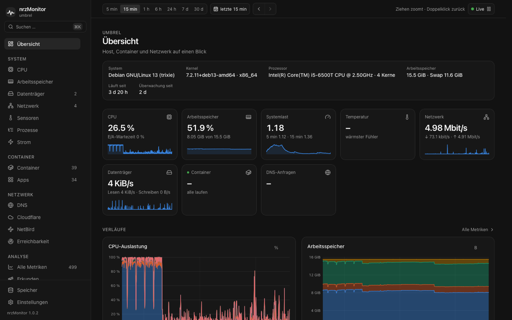

# nrzMonitor

**English** — A Rust-powered real-time monitoring tool.

**Deutsch** — Ein in Rust geschriebenes Echtzeit-Monitoring-Tool.

**Español** — Una herramienta de monitorización en tiempo real escrita en Rust.
